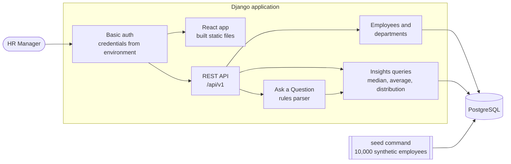
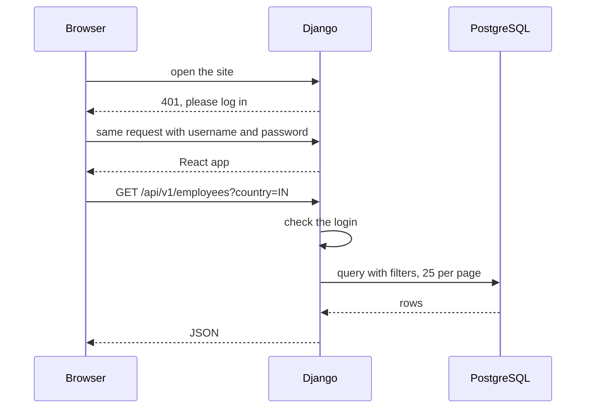
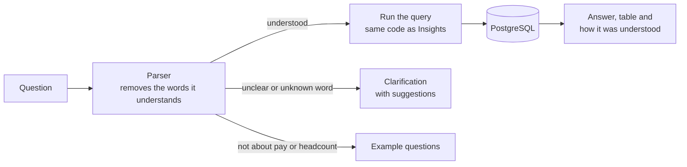
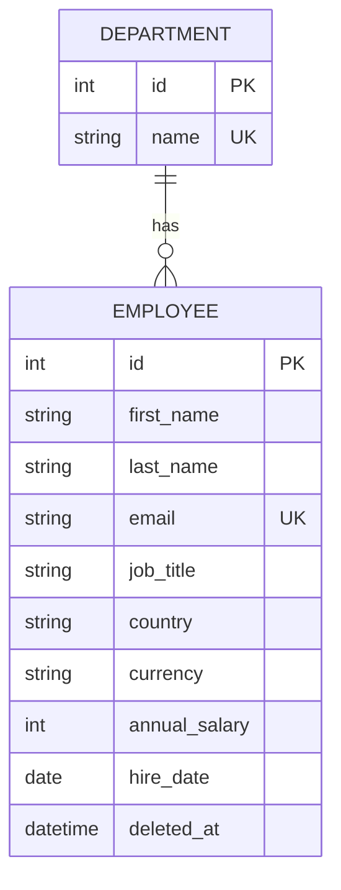

# Architecture

Diagrams are written in Mermaid, which GitHub draws automatically.

## 1. The system

One Django application serves both the React app and the API, and everything sits behind one login.

Django serves the built React app once deployed. In local development the Vite dev server runs the React app and proxies `/api` to Django, and auth is off.

## 2. A request, from login to data

The browser shows its own login box once, then sends the login with every request automatically.

## 3. How a question is answered

Fixed rules turn the question into a small query, and the database calculates the answer.

## 4. The data

Salary is a whole number in the employee's own currency, so figures are never mixed across currencies. Deleting sets `deleted_at` and the record is kept.

